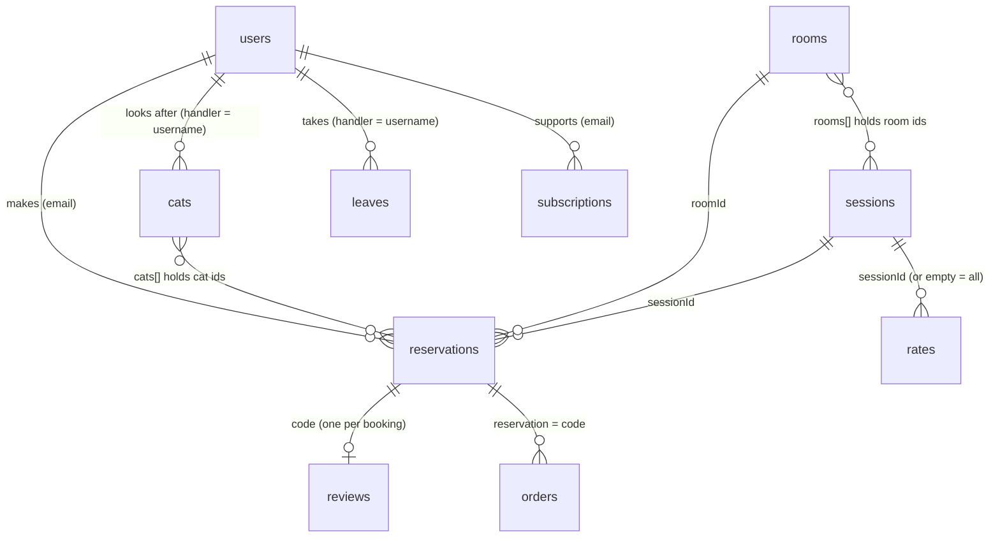

# The data model: collections (tables), fields (columns) and relations

The same model is written as code in `models/index.js`. This page explains it in words.

## MongoDB words, in table words

| MongoDB | What you may know | Example |
|---|---|---|
| database | database | `catcafe` |
| **collection** | table | `reservations` |
| **document** | row | one booking |
| **field** | column | `date`, `hours`, `guests` |
| an id stored in another document | foreign key (relation) | `reservation.roomId` holds a room's `id` |

MongoDB does not check relations for you. A relation is just a field that holds the other document's id. **Our server does the checking**: you cannot book a room that does not exist, delete a room that has bookings, and so on.

## The picture

In words: a **guest** (`users`) makes a **reservation** for a **session** in a **room**, choosing some **cats**. Each cat has a **handler** (a staff `user`), and the handler of the chosen cats looks after the session. The price comes from a **rate** for that session and kind of day. After the session the guest leaves one **review** (the handler and each cat), and can place **orders** from the menu.

## The collections

Mongoose names the collections like this: `rooms`, `sessions`, `rates`, `holidays`, `cats`, `events`, `menuitems`, `faqs`, `feedbacks`, `subscriptions`, `leaves`, `reservations`, `reviews`, `orders`, `configs`, `users`. Every document also gets MongoDB's own `_id`, which we do not use.

### `reservations`: the bookings (the main collection)
Unique key: `code` (for example `CC-K7Q2M`, the code the guest keeps).

| Field | Type | Meaning |
|---|---|---|
| `code` | text | the booking code |
| `name`, `email`, `phone` | text | the guest, copied from their account. **`email` -> `users.email`** |
| `sessionId`, `session` | text | **-> `sessions.id`**, and the session's name when booked |
| `roomId`, `roomCode`, `roomName`, `zone` | text | **-> `rooms.id`**, plus the room's names when booked |
| `date` | `YYYY-MM-DD` | the day |
| `time`, `endTime` | `HH:MM` | start and end (the guest chose the start and the hours) |
| `hours` | number | how many hours (1 to 12) |
| `guests` | number | how many people |
| `requests` | text | the guest's note |
| `cats` | list of text | **-> `cats.id`**: the cats the guest chose |
| `catNames` | list of text | their names when booked (so a rename does not rewrite history) |
| `handler`, `handlerUsername` | text | the handler's name, and **-> `users.username`** |
| `handlerBy` | `cat` / `random` / `fallback` / `leave` / `admin` | how the handler was chosen |
| `rateName`, `pricePerHour`, `amount` | text, number, number | the price **as it was when booked** (**-> `rates`**, but copied, so a later price change does not change old bookings) |
| `paid` | true/false | |
| `payment` | `{ method, ref, amount, paidAt }` | `method` is `PayNow` or `Card` |
| `status` | `Requested` / `Assigned` / `Concluded` / `Cancelled` | `Assigned` is what the pages call **Confirmed** |
| `createdAt` | time text | |
| `checkedIn` | number | guests who arrived (set by the handler) |
| `needsHandler`, `needsAttention`, `changeNote` | true/false, text, text | flags for the admin, and a note for the guest (for example "Fluffy is unwell, so Moody will be with you instead") |
| `refund`, `refundPercent`, `cancelledBy`, `cancelledAt` | | set when cancelled |
| `pricePerGuest`, `assignedBy`, `reopenedReason` | | only on bookings made by older versions |

### `rooms`
Unique key: `id`.
| Field | Meaning |
|---|---|
| `id`, `code`, `name` | for example `P1`, `P1`, `Private Room 1` |
| `type` | `Private` (one booking at a time) or `Open` (shared, up to `capacity`) |
| `capacity` | most people |
| `from`, `to` | optional own opening hours (empty = follow the cafe) |
| `active` | false = guests cannot book it |

### `sessions`
Unique key: `id`.
| Field | Meaning |
|---|---|
| `id`, `name`, `max` | for example `ps`, `Private Cat Session`, 6 people |
| `rooms` | list of **`rooms.id`**: where it can be held |
| `minHours`, `maxHours` | how many hours a guest can book |
| `catChoice`, `maxCats` | do guests choose their cats, and how many |
| `active` | |

### `rates`: prices per hour
Unique key: `id`.
| Field | Meaning |
|---|---|
| `name` | for example `Private Cat Session - weekend` |
| `sessionId` | **-> `sessions.id`**, or empty for every session |
| `dayType` | `all`, `weekday`, `weekend` or `holiday` (the most specific one that applies is used) |
| `pricePerHour` | the price for the whole room per hour, **not** per guest |
| `active` | |

### `cats`
Unique key: `id`.
| Field | Meaning |
|---|---|
| `id`, `name`, `relation`, `notes` | `notes` is a list of lines |
| `photo` | a picture path, or a small picture saved as text |
| `active`, `note` | false = resting or unwell, and `note` is why |
| `handler` | **-> `users.username`**: the staff member who looks after this cat |

### `holidays`
`id`, `date`, `name`, `mode` (`open` or `closed`), `from`, `to` (the hours if open). The Singapore public holidays are the starting data.

### `leaves`: staff leave
`id`, `handler` (**-> `users.username`**), `start`, `end`, `reason` (`Sick`, `Urgent leave`, `Annual leave`, `Other`), `note`, `createdAt`.

### `reviews`
Unique key: `id`. One per booking.
| Field | Meaning |
|---|---|
| `code` | **-> `reservations.code`** |
| `email`, `name`, `session`, `date` | who wrote it, and about which session |
| `handler`, `handlerName`, `handlerStars`, `handlerComment` | **-> `users.username`**, 1 to 5 stars and the words |
| `cats` | list of `{ id, name, stars, comment }` (**id -> `cats.id`**) |

### `orders`: food and drink
Unique key: `code` (for example `OR-1001`).
`reservation` (**-> `reservations.code`**), `zone`, `handler`, `email`, `items` (a list of `{ name, qty, price }`, copied from the menu when ordered), `total`, `status` (`Ordered` or `Served`), `placed`.

### `menuitems`
`id`, `name`, `category` (`Drinks` or `Snacks`), `price`, `available`, `photo`, `description`, `allergens` (a list from: Dairy, Eggs, Gluten, Peanuts, Tree nuts, Soy, Fish, Shellfish, Sesame). **If `allergens` is missing, the page says "Allergen details not added yet"; an empty list means "no common allergens".**

### `subscriptions`: "Support us"
`id`, `email` (**-> `users.email`**), `name`, `tier` (`friend`, `parent` or `guardian`), `price`, `startedAt`, `status` (`active` or `cancelled`), `cancelledAt`.

### `feedbacks`, `faqs`, `events`
- `feedbacks`: `id`, `type` (`Feedback`, `Question`, `Complaint`, `Compliment`), `name`, `email`, `message`, `sent`, `status` (`New`, `Done`, `Published`)
- `faqs`: `id`, `q`, `a`
- `events`: `id`, `title`, `start`, `end`, `text`, `guest`, `offer`

### `configs`: single settings documents
Each document is `{ key, value }`:
- `openHours`: `{ weekly: [7 days of { open, from, to }, Sunday first], closedPeriods: [{ id, name, from, to }] }`, for example the lunch break
- `settings`: `{ breakMinutes }`, the rest after every session
- `meta`: `{ seeded: true }`, remembers that the starting data was added, so it is never added twice

### `users`: people who can log in
| Field | Meaning |
|---|---|
| `role` | `guest`, `handler` or `admin` |
| `email`, `phone` | guests log in with their email |
| `username`, `contact` | staff log in with their username; `contact` is the email shown to guests |
| `name` | |
| `passwordHash` | **a scrambled password. The real password is never saved anywhere.** |
| `resetCodeHash`, `resetExpires`, `resetTries` | the forgot-password code (also scrambled) |

## What the server enforces
- A booking is only saved if the room, the cats and a handler are free, the hours fit the opening hours and lunch, and there is a rate (`bookings.js`, run by the server).
- Everything that changes a booking goes through the server, **one at a time**, so two guests cannot take the same slot.
- You cannot delete a room, session or cat that is used by a booking, and a cat must have a handler who exists.
- Fields the model does not know are thrown away when the admin saves a list.

## Who may see what
| | Visitor | Guest | Handler | Admin |
|---|---|---|---|---|
| rooms, sessions, rates, holidays, cats, menu, events, FAQ, hours | yes | yes | yes | yes |
| other people's bookings | only room, time, cats, handler (no names, no codes) | same | same, plus full details of **their own sessions** | everything |
| their own bookings, orders, subscription | | yes | | |
| leave reasons | "Leave" only | "Leave" only | their own | all |
| review comments | stars only | their own, in full | about themselves | all |
| feedback messages, all subscribers | | | | yes |

## Looking at the data yourself
- **Atlas:** your cluster -> **Browse Collections**. You see every collection above and can edit a document by hand (be careful).
- **MongoDB Compass** (free app): connect with the same connection string.
